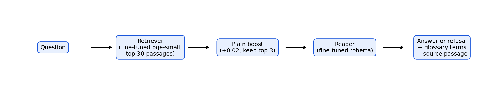
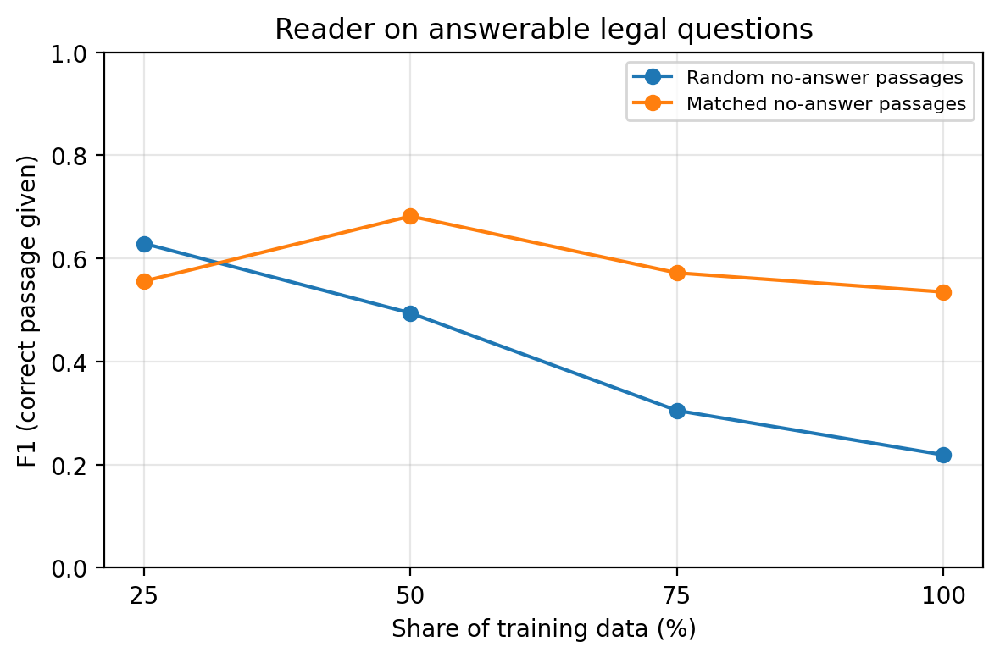

# Ask My Pension

A question answering assistant for the Nigerian Contributory Pension Scheme (CPS),
built for ordinary workers with no finance background.

A worker types a plain question such as "What is an RSA?" or "Can I have more than
one RSA?" and gets a short answer taken from official pension documents, simple
explanations of any pension terms in that answer, and the document and passage the
answer came from. Questions outside the pension domain get a polite refusal instead
of a guess.

## Project links

- Live app: https://ask-my-pension.streamlit.app/
- Demo video: https://canva.link/hn1b4m9v33tq0nh
- GitHub repository: https://github.com/michael-alu/ask-my-pension
- Report: submitted as a PDF with the assignment

The live app runs on the free tier of Streamlit Community Cloud. If it has been idle,
it may show a "wake up" button first and take a minute or two to start.

## The problem

Under the CPS, every worker has a Retirement Savings Account (RSA) with a Pension
Fund Administrator (PFA) of their choice, and has to make their own decisions:
which PFA to use, when to move their RSA, whether to make voluntary contributions,
and what happens when they lose a job or retire. The answers exist in documents
from the National Pension Commission (PenCom) and the PFAs, but those documents
are long and hard to read. Their mean Flesch Reading Ease is 36.5 for the FAQs
written for workers and 34.4 for the regulations, where anything below 50 counts
as "difficult".

The system works in English, because the pension regulations and guidelines are
published in English, Nigeria's official language.

## How the system works



1. **Retriever.** Finds the passages most likely to hold the answer. The baseline
   is BM25. The final system uses `BAAI/bge-small-en-v1.5`, a small sentence
   embedding model, fine-tuned on question and passage pairs from our training
   split. It returns the top 30 passages.
2. **Plain boost.** Passages written for workers (`plain`) get +0.02 on their
   similarity score, so they win close calls against legal text. The top 3
   passages go to the reader.
3. **Reader.** `deepset/roberta-base-squad2`, fine-tuned on our training split,
   points at the exact answer span in each passage or says the passage has no
   answer. The answer with the highest margin over "no answer" is returned, but
   only if that margin is above a threshold tuned on the validation split.
4. **Glossary.** Pension terms in the answer (RSA, PFA, Programmed Withdrawal and
   others) are shown with a plain explanation written by hand.

## Dataset

| Part | Size |
|---|---|
| Source documents | 12 public documents from PenCom, Trustfund Pensions and FCMB Pensions ([data/sources.csv](data/sources.csv)) |
| Passages | 1,559 (428 plain, 1,131 legal): FAQ answers, numbered clauses and definitions |
| FAQ question and answer pairs | 422, written by PenCom and the PFAs |
| Hand-written questions | 64 in a worker's own words, with hand-marked answers (52 test, 9 validation, 3 train; 13 unanswerable on purpose) |
| Out-of-domain questions | 45 the system should refuse, in three tiers: far, mid and near |
| Glossary | 17 pension terms explained in plain words |

The data is split by document section, never by question, so questions about the
same section never appear in both training and test. Passages: 1,049 train, 220
validation, 290 test. The split was frozen before any annotation was written.

The raw documents belong to their publishers and are not stored here. The download
script fetches them, and [data/raw/manifest.csv](data/raw/manifest.csv) records a
checksum for each one.

## Results

All numbers are on the test split. Settings were chosen on training and validation
data only.

**Retrieval** (125 answerable test questions)

| Retriever | Recall@1 | Recall@5 | MRR@10 |
|---|---|---|---|
| BM25 (baseline) | 0.280 | 0.464 | 0.354 |
| bge-small, zero-shot | 0.352 | 0.568 | 0.442 |
| bge-small, fine-tuned (final) | **0.456** | **0.704** | **0.558** |
| MiniLM, fine-tuned | 0.416 | 0.648 | 0.511 |

**Full system** (134 test questions, 45 out-of-domain questions)

| System | End-to-end EM | End-to-end F1 | Out-of-domain refusal |
|---|---|---|---|
| BM25 + roberta zero-shot (baseline) | 0.015 | 0.190 | 0.578 |
| fine-tuned bge + fine-tuned roberta (final) | **0.306** | **0.478** | 0.689 |
| fine-tuned bge + fine-tuned tinyroberta | 0.336 | 0.479 | 0.400 |

tinyroberta scores about the same but answers 60% of off-topic questions, so the
app uses roberta: for questions about money, a confident wrong answer is worse
than a refusal.

**What we learned**

- **Retrieval is the bottleneck.** Given the right passage, the fine-tuned reader
  scores F1 0.762. End to end it scores 0.478, and the largest group of errors is passages
  the retriever missed.
- **A default setting hid the effect of fine-tuning.** The Hugging Face question
  answering pipeline returns at most 15 answer tokens by default, while most gold
  answers are longer. Raising the limit to 300 took the fine-tuned reader from
  F1 0.137 to 0.762 with the right passage given.
- **A shortcut in the training data.** With randomly chosen "no answer" passages,
  the reader learned that legal text means "no answer" and refused 73% of
  answerable legal questions. Choosing "no answer" passages of the same style
  removed the cue (legal F1 0.22 to 0.54).
- **Preferring plain sources barely helps readability** (less than one Flesch
  point) and hurts legal retrieval, so explaining terms with the glossary matters
  more.



Every experiment is listed in [results/experiments.md](results/experiments.md), and
the error analysis, with real examples and a manual review of 36 answers, is in
[results/error_analysis.md](results/error_analysis.md). All figures are in
[results/figures/](results/figures/).

## Repository layout

```
data/raw           untouched downloaded documents plus a manifest
data/processed     cleaned documents split into passages
data/annotations   question and answer pairs written by hand
data/splits        train, validation and test splits
data/glossary      pension terms and their simple explanations
src                reusable code
scripts            runnable steps (download, process, train, evaluate)
notebooks          training notebooks for Google Colab or Kaggle
app                the deployed web app
results            metrics, tables and figures
```

## How to run

Needs Python 3.10 or newer. Create a project environment and install the
dependencies:

```
python -m venv .venv
source .venv/bin/activate
pip install -r requirements.txt
```

The versions in `requirements.txt` are chosen so the project runs the same on an
Intel Mac (where PyTorch stops at 2.2.2), on Google Colab and in a Codespace.

All code is type annotated. Check the types the way `tsc` would, with:

```
mypy src scripts
```

### 1. Get the source documents

The source documents belong to their publishers, so they are not stored in this
repository. The list of sources is in [data/sources.csv](data/sources.csv).
Download them with:

```
python scripts/download_sources.py
```

This saves every document, untouched, into `data/raw/`. Compare the checksums
against [data/raw/manifest.csv](data/raw/manifest.csv) to confirm you have the
same copies we used.

### 2. Build the passages

```
python scripts/build_passages.py
```

This cleans the documents and writes `data/processed/passages.jsonl`. FAQ answers
become one passage each, with their question kept next to them. Legal documents
become one passage per numbered clause, plus one per row of their definitions
tables. Every passage records its source, section, whether the source is `plain`
(written for ordinary workers) or `legal`, its Flesch Reading Ease score, and any
rates or naira amounts that may go out of date.

### 3. Stats and glossary suggestions

```
python scripts/passage_stats.py
python scripts/suggest_glossary_terms.py
```

The first writes [results/passage_stats.json](results/passage_stats.json). The
second counts the most common pension acronyms and phrases into
[data/glossary/term_candidates.csv](data/glossary/term_candidates.csv). The
glossary itself, [data/glossary/glossary.csv](data/glossary/glossary.csv), is
written by hand.

### 4. Freeze the train, validation and test split

```
python scripts/make_splits.py
```

Passages are split by section, never one by one, so questions about the same
section cannot appear in both training and test. The result,
[data/splits/sections.json](data/splits/sections.json), is committed and frozen
before any annotation is written.

### 5. Annotate

```
python scripts/make_review_files.py
python scripts/annotation_tool.py
```

The first creates the review files in `data/annotations/` and never overwrites
them. The second opens a local page for writing annotations, which are saved to
`data/annotations/annotations.jsonl` as passage IDs and answer positions. The
passage text is not stored, because it belongs to the publishers.

FAQ questions are not span-annotated by hand. The FAQ answers were written to answer
their questions directly, so each whole answer is used as the answer span, by rule.
Their beginner or detailed level is labelled by hand in `faq_levels.csv` for the test
and validation splits. Hand annotation focuses on what the FAQ cannot provide:
questions written the way workers ask them, questions about the legal passages, and
questions that a passage does not answer.

### 6. Evaluate the BM25 baseline retriever

```
python scripts/evaluate_bm25.py
```

BM25 ranks every searchable passage for each evaluation question: the FAQ questions,
whose gold passage is their own answer, and the hand-written questions. It reports
Recall@1, Recall@5 and MRR@10 on the validation and test splits, broken down by
question origin, source style and level, plus the reading ease of the top passage.
Results go to `results/bm25_results.json`, and every experiment adds a row to
[results/experiments.md](results/experiments.md).

### 7. Build the SQuAD files

```
python scripts/export_squad.py
```

Turns the FAQ pairs and the annotations into SQuAD 2.0 style examples in
`data/squad/` (one file per split). Each example records where it came from:
`faq_rule` (an FAQ question with its whole answer as the span), `faq_human`
(an FAQ question whose span was marked by hand) or `own` (a hand-written question).

### 8. Evaluate a dense retriever

```
python scripts/evaluate_dense.py BAAI/bge-small-en-v1.5
```

Scores a dense retriever exactly like BM25, so the numbers compare directly. It
takes an off-the-shelf model name or a fine-tuned model folder.

### 9. Evaluate a reader

```
python scripts/evaluate_reader.py deepset/roberta-base-squad2 bm25
```

The first argument is the reader (a model name or a fine-tuned folder), the second
is the retriever (`bm25`, or a dense model). The reader is scored with Exact Match
and F1 in two settings: given the gold passage (the reader alone), and end to end
on the retriever's top 3 passages (the whole system). It also measures the refusal
rate on the out-of-domain questions. The no-answer threshold is tuned on the
validation split and then applied unchanged to test.

### 10. Fine-tune on Google Colab

Open [notebooks/train_on_colab.ipynb](notebooks/train_on_colab.ipynb) in Colab with
a T4 GPU, upload `data/processed/passages.jsonl`, and run the cells in order. It
fine-tunes both retrievers (`scripts/train_retriever.py`) and both readers
(`scripts/train_reader.py`), evaluates every combination, repeats training on 25%,
50% and 75% of the data, and gives back `results.zip` to copy into `results/`.

The reader learns "no answer" from training questions paired with passages from
other documents. How those passages are chosen is itself an experiment. `random`
picks any passage, which taught the reader a shortcut: nearly every answerable
example was plain text and most no-answer passages were legal, so it learned that
legal text means "no answer". `matched` (the default) picks a passage of the same
style that shares at most one key word with the question, which removes the shortcut.

### 11. The plain-language preference experiment

```
python scripts/evaluate_plain_boost.py models/retriever-bge-small-en-v1.5-100pct models/reader-roberta-base-squad2-100pct-matched
```

Plain passages get a small boost before re-ranking, so they win close calls against
legal passages. The script sweeps several boost sizes and reports what each does to
retrieval (overall, FAQ, own, plain, legal), to end-to-end F1, and to readability.
The app's boost (0.02) is fixed by design rather than tuned, because the validation
split has no legal questions and so cannot show what a boost costs.

### 12. Error analysis

```
python scripts/error_analysis.py
```

Sorts every test question into one outcome (correct, retriever missed the gold
passage, gold passage read but the answer taken from another, wrong span, partly
right, refused when answerable, answered when it should have refused), with counts
by slice and real examples, in [results/error_analysis.md](results/error_analysis.md).
Because the documents overlap, an answer from a different passage can still be
right, so those cases go to `results/manual_review.csv` to be checked by hand.

To draw the report's figures from the results files into `results/figures/`:

```
python scripts/make_figures.py
```

### 13. Run the app

```
streamlit run app/streamlit_app.py
```

The app needs the two fine-tuned models in `models/`: either train them with step 10
and copy them in, or, with access, download them from the private assets repository
(step 14).

The app answers with the same models and settings as the experiments: the fine-tuned
bge retriever, the 0.02 plain boost, the top 3 passages, the fine-tuned reader and the
no-answer threshold tuned on validation. It shows the answer first, simple
explanations of any glossary terms in it, and the passage and document it came from.
If no answer clears the threshold, it politely refuses. The first start embeds every
passage and saves the result to `models/passage_embeddings.npy`, so later starts are
quick. On a laptop CPU an answer takes under two seconds, and the app uses about
800 MB of memory.

To see every step the system takes for one question (BM25 for comparison, the
retriever's scores, the plain boost, the reader's margins and the final decision):

```
python scripts/explain_answer.py "What is an RSA?"
```

### 14. Deploy on Streamlit Community Cloud

The models (about 620 MB) cannot go in git, and the passages hold the publishers'
text, so both live in a private Hugging Face model repository that the app downloads
from on its first start.

```
python scripts/prepare_assets.py
hf auth login
hf upload michael-alu/ask-my-pension-assets assets . --private
```

Then create the app on [Streamlit Community Cloud](https://share.streamlit.io) from
this GitHub repository, with `app/streamlit_app.py` as the main file and Python 3.10
or newer. Under Advanced settings, add two secrets:

```
HF_ASSETS_REPO = "michael-alu/ask-my-pension-assets"
HF_TOKEN = "<a Hugging Face token that can read it>"
```

The app's own dependencies are in `app/requirements.txt`, which uses the CPU-only
build of PyTorch to keep the install small.

## Limitations

- The hand-written test set is small (52 questions) and was written by one person.
- The training and validation splits have few hand-written questions and none
  about legal passages, so fine-tuning mostly learned FAQ wording.
- Scoring assumes one correct passage per question, but the documents overlap.
- The Pension Reform Act itself is not included, because its PDF text layer is broken.
- The system answers in English only. Igbo, Yoruba and Hausa support through an
  existing translation model is future work.

## Acknowledgements and licensing

- Source documents: National Pension Commission (PenCom), Trustfund Pensions and
  FCMB Pensions. They are not redistributed here.
- Models: `deepset/roberta-base-squad2` and `deepset/tinyroberta-squad2`
  (CC-BY-4.0), `BAAI/bge-small-en-v1.5` (MIT),
  `sentence-transformers/all-MiniLM-L6-v2` (Apache-2.0).
- Libraries: Hugging Face Transformers, sentence-transformers, rank-bm25,
  pdfplumber, textstat, matplotlib, Streamlit and Gradio.

The full list of papers and sources is in the report.

This is a student project. It is not official financial or legal advice, and it
is not connected to or endorsed by PenCom or any pension fund administrator.
